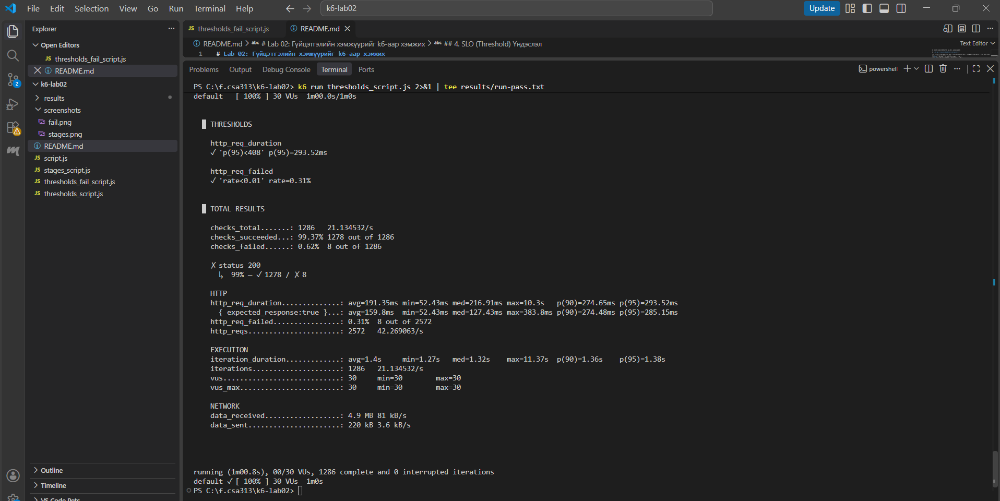
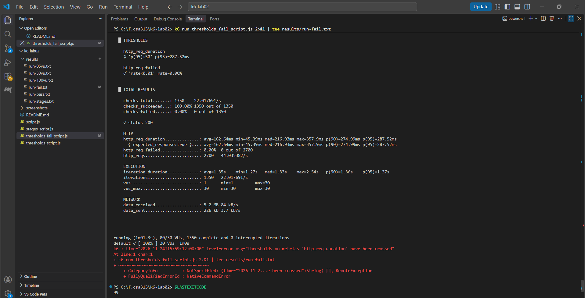
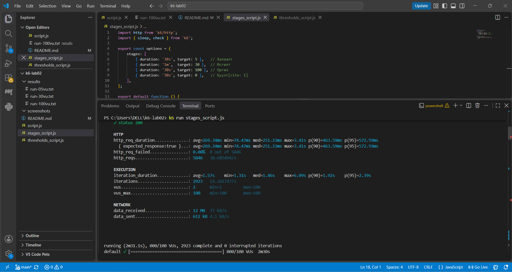

# Lab 02: Гүйцэтгэлийн хэмжүүрийг k6-аар хэмжих

**Оюутны нэр:** Д.Гантогтох
**Оюутны код:** B242270139

## 1. k6 Version

k6 v2.2.0 (commit/00a9a1b7f5, go1.26.5, windows/amd64)

## 2. Гурван түвшний (5/30/100 VU) хэмжилтийн хүснэгт

| VU Түвшин | http_req_duration (p90) | http_req_duration (p95) | Throughput (http_reqs/s) | Error Rate (http_req_failed) |
| :--- | :--- | :--- | :--- | :--- |
| **5 VU** | 265.55ms | 271.92ms | 6.96 reqs/s | 0.00% |
| **30 VU** | 289.32ms | 309.05ms | 42.09 reqs/s | 0.00% |
| **100 VU** | 303.12ms | 380.72ms | 137.43 reqs/s | 0.00% |

## 3. Stages туршилт — АЖИГЛАЛТ (алдаа гарсан)

Эх сурвалж: results/run-stages.txt (stages_script.js: 5→30→100→0 VU, 2м30с)

checks_succeeded: 20.48% (42/205)
http_req_failed:  64.42% (163/253)
http_req_duration: avg=7.47s  p90=30.35s  p95=1m0s (timeout)

Энэ бол run-100vu.txt-ийн steady-state 100 VU (0% алдаа) үр дүнгээс эрс ялгаатай. Steady load (тогтмол 100 VU шууд эхлэх) ба ramping load (5-аас 100 хүртэл аажим өсөх) ижил дээд VU-тэй ч огт өөр үр дүн өгсөн нь: (1) test.k6.io нь гадаад, олон хэрэглэгч зэрэг ашигладаг демо сервер тул тогтмол багтаамжтай биш байж болно; (2) Windows дээр их хэмжээний зэрэгцээ connection нээгдэхэд ephemeral port / socket хязгаарт хүрсэн байж болно; (3) VU тоо огцом өсөхөд (ялангуяа 1m23s-с хойш хурдан ramp хэсэгт) сервер рүү connection storm үүссэн байж болзошгүй. Энэ нь steady-state тестийн p95-аас ganц дээд VU тоог хараад дүгнэх нь хангалтгүй, харин ачаалал нэмэгдэх хурд (ramp rate) өөрөө тусдаа хэмжигдэхүүн болохыг харуулж байна.

## 4. SLO (Threshold) Үндэслэл
Baseline тооцоолол

5 VU baseline (Алхам 2, run-05vu.txt): p95 = 271.92ms

SLO threshold = baseline × 1.5 = 271.92 × 1.5 ≈ 408ms

Pass туршилтын үр дүн (results/run-pass.txt)
thresholds_script.js дотор p(95)<408 босго тавьж ажиллуулахад дараах бодит үр дүн гарч PASS болсон:

Бодит p95 latency: 293.52ms (✓ 'p(95)<408')

Throughput: 42.27 req/s (2572 requests)

Error Rate: 0.31% (8 out of 2572) (✓ 'rate<0.01')

Анхаарах зүйл: энэ run-д 8 хүсэлт амжилтгүй болсон тул `status 200` check 99.37% (1278/1286) байсан ба терминалд `✗ status 200` гэж харагдана. Гэвч http_req_failed = 0.31% нь SLO-ийн 1%-ийн хязгаараас доогуур тул threshold-ууд хангагдаж, тест PASS болсон.

FAIL демонстраци (results/run-fail.txt, thresholds_fail_script.js)
Босгыг санаатайгаар p(95)<50ms болгож (baseline p95 = 271.92ms-ээс ч доош), бусад тохиргоог (30 VU, 1м) хэвээр үлдээсэн. Бодит p95 = 287.52ms (p90 = 274.99ms, max = 357.9ms) тул `p(95)<50` босго зөрчигдөж (✗), харин `rate<0.01` биелсэн (✓, 0.00%, 2700 хүсэлт). Нэг threshold зөрчигдөхөд бусад нь хангагдсан байсан ч тест нийтдээ FAIL болдог.

Threshold зөрчигдөхөд k6 терминалд `level=error msg="thresholds on metrics 'http_req_duration' have been crossed"` гэж хэвлэж, процессыг exit code 99-өөр дуусгасан (`$LASTEXITCODE` = 99, screenshots/fail.png-д харуулсан). CI pipeline яг энэ exit code-оор build-ийг автоматаар зогсоодог.

Дахин ажиллуулах: `k6 run thresholds_fail_script.js 2>&1 | tee results/run-fail.txt; echo $LASTEXITCODE`

## 5. Дэлгэцийн зургууд

### Threshold PASS

### Threshold FAIL

### Stages Test Output

## 6. Дүгнэлт
1. VU тоо 5-аас 100 болоход throughput 6.96-аас 137.43 req/s болж (≈19.7 дахин) VU-тэй бараг шугаман өссөн.
2. Харин p95 latency 271.92ms-ээс 380.72ms (≈1.4 дахин) болж, p90 нь 265.55ms-ээс 303.12ms хүртэл бага зэрэг өссөн нь ачаалал нэмэгдэх тусам "хэрэглэгчийн туршлага" аажим муудаж байгааг харуулна.
3. Хамгийн тод өөрчлөлт 100 VU дээр гарсан: max latency 1.02s хүрч, p95 нь 30 VU-ийн 309.05ms-ээс 380.72ms болсон тул "хэрэглэгчийн туршлага" муудаж эхэлсэн цэг 30–100 VU-ийн завсарт байна.
4. Гурван steady-state түвшинд error rate 0.00% байсан тул энэ ачааллын хүрээнд availability алдагдаагүй.
5. Гэтэл ижил дээд 100 VU-тэй ramping (stages) ажиллуулалт бүтэлгүйтэж, http_req_failed 64.42%, checks_succeeded 20.48%, p95 = 1м (timeout) болсон нь Лекц 2-ын latency, throughput, error rate гурвыг тусад нь бус хамтад нь хянах ёстойг батлав.
6. Steady ба ramping ачаалал ижил дээд VU дээр ч эрс өөр үр дүн өгсөн нь VU-ийн тоо ганцаараа ачааллыг тодорхойлдоггүй, ачаалал өсөх хурд мөн чухал гэдгийг харуулсан; шалтгааныг (гадаад сервер, Windows socket хязгаар, connection storm) би хэмжилтээр баталгаажуулаагүй, зөвхөн таамаглал.
7. SLO-оо 5 VU baseline p95 (271.92ms) × 1.5 ≈ 408ms гэж тодорхойлсон, учир нь baseline-аас хангалттай зайтай боловч хэрэглэгчийн мэдрэгдэхүйц удаашралыг мөрдөх хэмжээнд байна.
8. Энэ SLO-г 30 VU дээр шалгахад p95 = 293.52ms, error rate = 0.31% (2572 хүсэлтээс 8 нь амжилтгүй) гарч босго хоёулаа хангагдсан (PASS); харин өмнөх тусдаа 30 VU run-д error rate 0.00% байсан тул гадаад серверийн хариу ажиллуулалт бүрт өөр байдгийг харуулна.
9. Тусад нь авсан p(95)<50 босготой FAIL run-д p95 = 287.52ms гарч босго зөрчигдөн k6 exit code 99-өөр дууссан бол error rate босго (0.00%) хангагдсан нь нэг threshold зөрчигдсөн ч тест нийтдээ FAIL болдог, CI pipeline-д quality gate яг ийм зарчмаар build-ийг зогсоодгийг батлав.